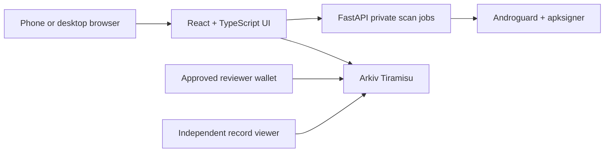

# ScamSignal + AppPassport

**Check an Android APK before installing it.** ScamSignal verifies its signature, explains declared permissions, compares it with reviewed release references, and reads creator-verified warnings from Arkiv.

The consumer flow is free and requires no account or wallet. English and Hindi explanations work on a phone. This is evidence-based static inspection, not a malware verdict or a safety certificate.

## Deployment targets

- [ScamSignal](https://scamsignal.ajnasnb.com)
- [Independent public-record viewer](https://scamsignal.ajnasnb.com/viewer)
- [Reviewer dashboard](https://scamsignal.ajnasnb.com/reviewer)
- [Scan API health](https://scamsignal-api-20261011.azurewebsites.net/api/health)
- [Motion-graphics explainer](https://scamsignal.ajnasnb.com/demo/scamsignal-explainer.mp4)
- [Presentation](https://scamsignal.ajnasnb.com/demo/scamsignal-app-passport.pptx)

The live scanner has been tested with all five APKs, and fresh Arkiv reads verified all five passports and both reviewed warnings. Evidence is in [`scanner/live-evaluation.json`](scanner/live-evaluation.json), [`arkiv/verification.json`](arkiv/verification.json), and [`arkiv/protocol-verification.json`](arkiv/protocol-verification.json).

## What works

1. Upload one `.apk`, up to 50 MiB. The browser computes the exact SHA-256.
2. A private server job verifies the Android signature with `apksigner` and reads the binary manifest with Androguard.
3. The browser checks that the server analyzed the same file.
4. AppPassport compares exact-file hashes and signing certificates with accepted reviewer records.
5. The client reads relevant advisories and authorized retractions directly from Arkiv Tiramisu.
6. The report separates file findings, identity comparison, public warnings, and incomplete coverage. It can be downloaded as JSON.

Five measured reports are available as clearly labelled **precomputed examples**. Opening an example still performs a fresh public-record lookup. The `/viewer` route uses an APK hash only, so existing records remain readable when the scan API is unavailable.

## Architecture



- `apps/web`: Vite frontend, English/Hindi workflow, upload integrity check, evidence report, public viewer, reviewer publishing.
- `scanner`: bounded static APK inspection, token-protected jobs, CLI, and five-application evaluation.
- `packages/arkiv-client`: reusable query, schema validation, creator-policy, correction, and publishing client.
- `arkiv`: entity schema, queries, reviewer addresses, and integration friction documentation.
- `tests`: scanner checks, Arkiv trust checks, and browser flow checks.

## Run locally

Use Node.js 22.12 or later, Python 3.11 or later, and a JRE compatible with Android Build Tools. Install Android Build Tools and locate `lib/apksigner.jar`, or use an installed `apksigner` executable on Linux.

```sh
npm ci
npm run dev
```

The frontend opens at `http://localhost:5173` and proxies `/api` to `http://127.0.0.1:8000`. In another terminal, run the scanner from the repository root:

```powershell
python -m venv .local/venv
.local/venv/Scripts/python -m pip install -r scanner/requirements-dev.txt
$env:APKSIGNER_JAR = 'C:\path\to\android-sdk\build-tools\35.0.0\lib\apksigner.jar'
$env:CORS_ORIGINS = 'http://localhost:5173'
.local/venv/Scripts/python -m uvicorn scanner.api:app --host 127.0.0.1 --port 8000 --no-access-log
```

Linux uses `.local/venv/bin/python` and shell `export` for environment variables. See [scanner setup](scanner/README.md) for Docker, the locked dependency environment, limits, and deployment boundaries.

For a separately hosted API, set `VITE_API_URL` to its HTTPS origin before `npm run build`. Uploads go directly to that API, not through a serverless frontend function. Set `CORS_ORIGINS` on the API to the frontend's exact origin.

## Arkiv integration

Tiramisu chain ID is **7738577**. Browser reads use the public RPC; consumer checks never request a wallet. Writes come from an approved reviewer wallet and use GLM testnet gas.

The public policy at [`apps/web/public/data/trust-policy.json`](apps/web/public/data/trust-policy.json) defines accepted **creator** addresses. The client validates protocol metadata and typed attributes against the payload. A publisher name inside JSON is never proof of authorship. An empty policy does not accept arbitrary writers.

- `passport`: reviewed release identity, exact APK hash, signing certificate fingerprints, and source reference.
- `advisory`: a scoped warning about an exact APK hash, with evidence and provenance.
- `correction`: an original creator's authorized retraction of a target passport or advisory.

Published payloads are readonly. Arkiv ownership, transfer, deletion, expiry, and historical retention remain separate properties. Expired records are excluded from live queries; expiry is not a safety clearance or a guarantee that historical data was erased. Main records have lifetimes that cover judging. Short-lived expiry experiments must use separate records so the judging dataset remains available.

The selected Arkiv property is an independently readable, wallet-authored public evidence layer. Private APK inspection can use conventional infrastructure; it is not claimed to require Web3. See [`arkiv/schema.md`](arkiv/schema.md) for exact queries and [`arkiv/friction.md`](arkiv/friction.md) for reproducible SDK integration evidence.

## Five-application evaluation

Real APKs were downloaded from upstream public sources and inspected without installation or execution. The two risky cases are intentionally insecure training applications, **not confirmed malware or scams**. Sensitive permissions in a legitimate application can be expected for its purpose.

| Application and exact source | Version | Signature | Declared permissions | Sensitive permissions | Findings |
|---|---|---|---:|---:|---:|
| [KeePassDX](https://github.com/Kunzisoft/KeePassDX/releases/tag/4.5.5) | 4.5.5 libre | Verified | 9 | 0 | 0 |
| [Aegis](https://github.com/beemdevelopment/Aegis/releases/tag/v3.4.3) | 3.4.3 | Verified | 6 | 1 | 1 |
| [NewPipe](https://github.com/TeamNewPipe/NewPipe/releases/tag/v0.29.1) | 0.29.1 | Verified | 11 | 2 | 1 |
| [InsecureBankv2](https://github.com/dineshshetty/Android-InsecureBankv2/tree/3c8cc3a3ce45ed56d0f58f236b541b41f992e51f) | commit `3c8cc3a` | Verified | 12 | 7 | 3 |
| [PIVAA](https://github.com/HTBridge/pivaa/tree/7fde8956083ec4c6023c75f013f72023d60eda12) | commit `7fde895` | Verified | 12 | 8 | 3 |

Method: Androguard **4.1.4** and Android Build Tools **35.0.0** signature verification. Results, file hashes, signing fingerprints, sources, licences, and analysis limits are in [`scanner/evaluation.json`](scanner/evaluation.json). Five examples demonstrate integration behavior; they do not establish detection accuracy.

```sh
python -m scanner.evaluate --download
```

This command downloads binaries into ignored `.local/samples`, keeps raw reports private, and exports sanitized metadata. No APKs are redistributed in this repository or offered by the product UI.

## Verification

```sh
npm run build
npm test
python -m pytest tests/scanner -q
npx playwright test --config tests/web/playwright.config.ts
```

Run the frontend before the browser checks. Browser tests use mocked scan responses, a simulated public-network outage, and controlled record fixtures to check mobile/Hindi usability, rejected input, private token handling, permission explanations, file-hash mismatch protection, distinct unknown/incomplete/unavailable identity states, and viewer updates and expiry. They do not substitute for live API or live-chain verification.

Scanner evaluation uses the five actual upstream APKs above. To enable optional real-file scanner integration tests, set `SCAMSIGNAL_INTEGRATION_APK` to a private local APK. See the scanner README for the exact environment.

## Scope, privacy, and limitations

- The APK is never installed or executed. DEX behavior, downloaded code, runtime grants, certificate rotation lineage, and later activity are not assessed.
- A valid signature verifies integrity and signing identity, not legitimacy. No matching warning does not mean safe.
- Arbitrary uploaded APKs and scan histories are not written to Arkiv. Raw uploads are deleted after processing; private in-memory reports expire after 30 minutes.
- Public records exclude raw binaries, certificate subject names, embedded strings, personal data, and secrets. Demo authors are project reviewers, not official authorities.
- Server-side uploads are private within this system's retention policy, not anonymous or end-to-end encrypted. Privacy is based on data minimization, not zero-knowledge claims.
- Process limits reduce parser risk but are not a complete operating-system sandbox. The demo is not a production antivirus service. A production deployment needs dedicated isolation, rate limits, and restricted worker egress.

## Hackathon fit

Primary target: **Best Indian Use Case**, subject to the team's nationality eligibility. The phone-first, free English/Hindi check addresses the moment before a received APK is installed.

Additional tracks: **Security** through creator verification and authorized retractions; **Open Source** through reusable entity contracts and the client library; **Censorship Resistance** through independent public reads when the analysis API is offline. We do not claim a full privacy solution.

The published deadline is **18 October 2026, 23:59 BST**, equivalent to **19 October, 04:29 IST**. [Event](https://arkiv.devfolio.co/), [rules](https://github.com/Arkiv-Network/global-tour-stop-pre-devcon/blob/main/RULES.md), [scoring rubric](https://github.com/Arkiv-Network/global-tour-stop-pre-devcon/blob/main/docs/scoring-rubric.md). Multiple tracks do not stack prize payments: one team can win one prize.

## Licence and attribution

The original ScamSignal application and reusable client are MIT-licensed; see [LICENSE](LICENSE). Dependencies and evaluation inputs retain their own licences. [NOTICE.md](NOTICE.md) identifies them. GPL APKs are evaluation inputs only; their code and binaries are not incorporated into this MIT application. The project does not claim affiliation with, endorsement by, or authorship of the sampled applications.
